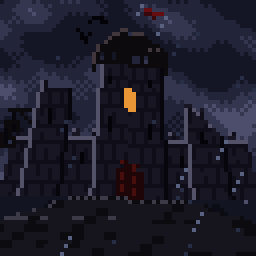
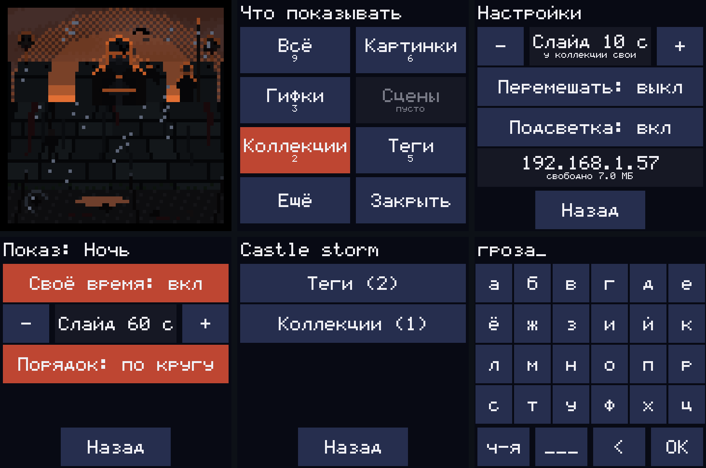
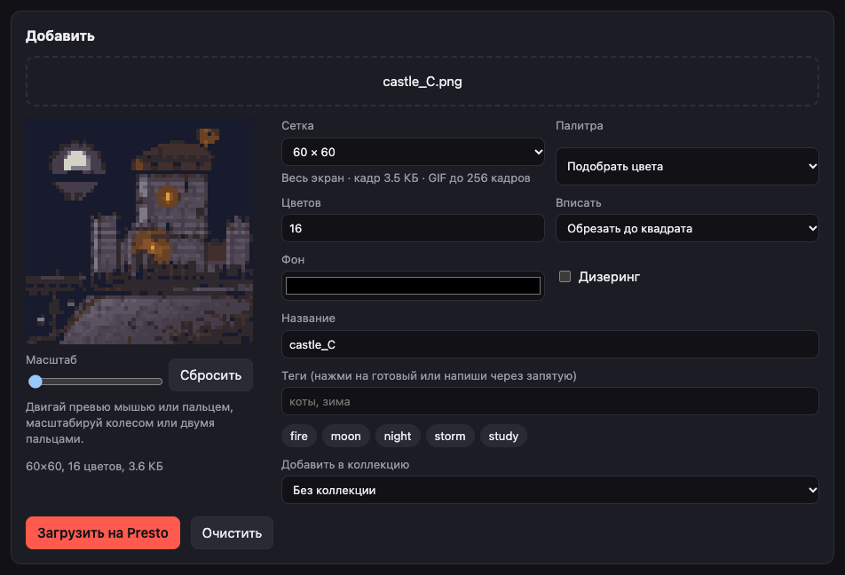
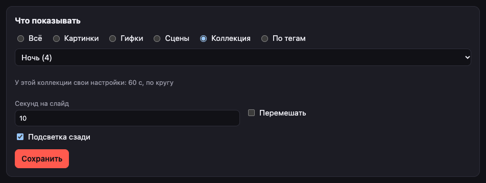
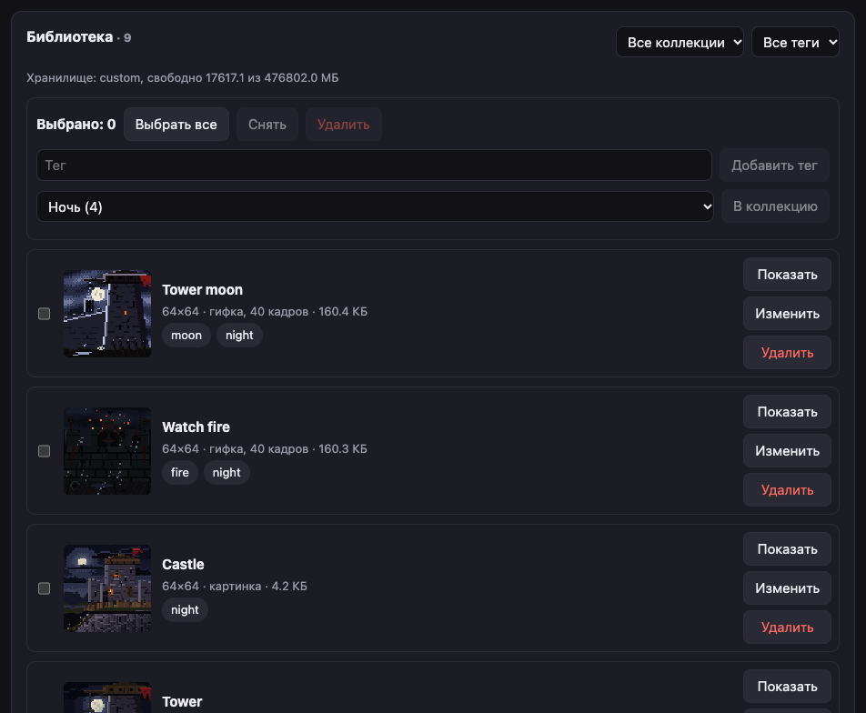
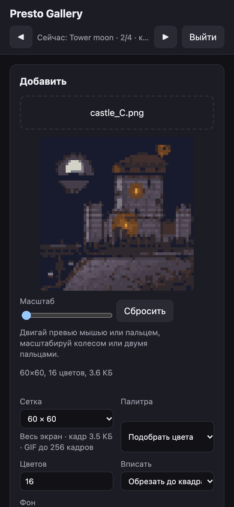

# Presto Gallery

A pixel art picture frame for the [Pimoroni Presto](https://shop.pimoroni.com/products/presto)
(RP2350, 480×480 touch screen, MicroPython).

- **Pixelizer.** Turns pictures into pixel art: a grid from 16 to 480 cells, an adaptive palette of 2
  to 256 colours or a fixed one (PICO-8), optional dithering. The desktop tool takes PNG, JPEG and
  WebP; the browser, with the same algorithm, also takes animated GIFs.
- **Wi-Fi gallery on the Presto.** The board serves a web page: upload pictures, GIFs and Scenes
  (small MicroPython programs that draw live), tag them, group them into Collections, choose what
  to show. On the device, swipes change slides and brightness, a tap pauses, and a long press opens
  a menu with an on-screen keyboard.
- **Living Scenes.** A Scene is a `.py` file with `run(stop)`; it can play a moment that never repeats
  (see [docs/scene-format.md](docs/scene-format.md)). Each Scene and each Collection has its own
  speed and slide time; in the "Сцены" mode a Scene plays until you swipe.
- **Ambient light.** The 7 LEDs on the back follow the colours at the edges of the screen.

The device menu and the web page are in Russian; the code and the docs are in English.

<p align="center">
  
</p>

## Screenshots

**On the Presto** (480×480): a picture on the screen, the menu "Что показывать", settings, a
Collection's own show settings, the menu of the current picture, the on-screen keyboard.



**In the browser**: adding a picture (the pixelization preview is live), what to show, the library.



<table>
  <tr>
    <td><br>
        </td>
    <td width="300"></td>
  </tr>
</table>

## Quick start: the pixelizer on the desktop

```bash
uv venv .venv && uv pip install -p .venv -e '.[dev]'
cp ~/Pictures/cat.jpg inbox/
.venv/bin/python -m presto_pic_loader            # defaults: --grid 32 --colors 16 --fit crop
.venv/bin/python -m presto_pic_loader --grid 64 --palette pico-8 --fit fit --dither
```

Results go to `outbox/`: `<name>.preview.png` and `<name>.bin` ([format](docs/bin-format.md)).
Options: `--grid 16|32|40|60|64|80|120|240|480`, `--colors 2..256` or `--palette pico-8`,
`--fit crop|fit`, `--background #RRGGBB`, `--dither`, `--preview-scale N`, `--inbox`, `--outbox`.
Exit codes: 0 ok, 1 some file failed, 2 bad options.

## Quick start: the gallery on a Presto

1. Flash the Presto with Pimoroni's MicroPython build for the Presto.
2. Copy `device/secrets.example.py` to `device/secrets.py` and fill in your Wi-Fi and a
   `WEB_PASSWORD`. This file is git-ignored; never commit it.
3. Copy the app to the board with `mpremote` and reset it. The screen shows the address to open.

Step by step, with the microSD card, gestures and the menu: [docs/device-setup.md](docs/device-setup.md).

No board at hand? The simulator serves the same web page and draws the screen to a PNG:

```bash
.venv/bin/python device/sim/run_sim.py 8080       # then open http://localhost:8080
```

## Security

- `WEB_PASSWORD` protects the whole `/api`. Without it the gallery is open to everyone on your
  network and Scene upload is off.
- The page is plain HTTP: the password crosses your local network unencrypted. Keep the Presto on a
  network you trust and do not expose it to the internet (no port forwarding).
- A Scene is code that runs with full access to the board, including `secrets.py`. Upload only Scenes
  you wrote or have read.

## Development

```bash
.venv/bin/pytest                      # desktop tool, device logic, golden vectors, layer guards
node --test web/test/                 # browser logic, golden vectors, GIF decoder
.venv/bin/python -m presto_pic_loader.golden   # regenerate golden vectors after changing the algorithm
```

The code is written in layers ("stratified design"): 1 primitives, 2 image and catalog operations,
3 pure rules (pipeline, playlist, menu), 4 codecs, 5 actions (files, network, screen). Each layer
calls only its own level or below; input and output happen only in layer 5. Tests guard the layer
rules in Python and JavaScript.

| Path | What |
|---|---|
| `src/presto_pic_loader/` | the desktop pixelizer |
| `web/` | the gallery's web page and the browser pixelizer |
| `device/` | the gallery on the board (`gallery/`), drawing helpers for Scenes (`pixel.py`), simulator |
| `docs/` | `.bin` format, pixelize algorithm, Scene format, device setup |
| `knowledge/domain.okf.json` | the shared vocabulary of the project |
| `specs/` | one folder per feature: spec, plan, tasks |

The browser and the desktop share one quantization algorithm, checked byte for byte by the golden
vectors in `tests/golden/`.

## Third-party code

- [microdot](https://github.com/miguelgrinberg/microdot) by Miguel Grinberg, MIT, vendored in
  `device/lib/microdot/` with its license.

## License

[MIT](LICENSE)
