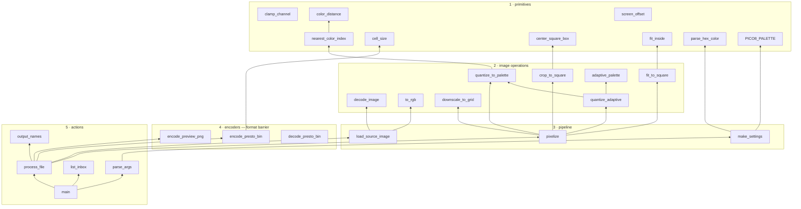

# Implementation Plan: Presto Pixelizer (MVP)

**Branch**: `001-presto-pixelizer` | **Date**: 2026-11-06 | **Spec**: [spec.md](spec.md)

## Summary

A Python CLI converts every image in `inbox/` into PixelArt (Grid 16/32/64, adaptive or PICO-8
Palette, crop/fit, optional dithering) and writes `<stem>.preview.png` and `<stem>.bin`
(PrestoBinFormat v1) into `outbox/`. Code is split into 5 stratified layers; layers 1–4 are pure.

## Technical Context

**Language/Version**: Python ≥ 3.10 (local 3.14)
**Primary Dependencies**: Pillow (runtime), pytest (dev) — installed into project-local `.venv`
**Storage**: files only (`inbox/`, `outbox/`)
**Testing**: pytest
**Target Platform**: macOS/Linux desktop; output consumed by MicroPython on Pimoroni Presto
**Project Type**: single project, CLI
**Performance Goals**: 4000×3000 photo < 2 s
**Constraints**: deterministic byte-identical output; nothing written outside the project folder
**Scale/Scope**: ~5 modules, ~500 LOC + tests

## Constitution Check

| Principle | Check | Status |
|---|---|---|
| I Stratified Design | 5 layers as modules; call graph below has no upward arrows or skips; I/O only in `l5_actions` | ✅ |
| II OKF vocabulary | Class/func names = OKF names (`SourceImage`, `PixelArt`, `Frame`, `PixelizeSettings`, `Palette`, `FitMode`…); a test checks dictionary rules | ✅ |
| III Tests | Unit tests per layer 1–4; integration test runs inbox→outbox on a real picture | ✅ |
| IV Format | Magic + version + frameCount + per-frame duration; `docs/bin-format.md`; reference decoder | ✅ |
| V Simplicity | Only Pillow + pytest; `.venv` inside the project | ✅ |

## Project Structure

```text
knowledge/domain.okf.json          # vocabulary (done)
docs/bin-format.md                 # byte layout for the Presto player
src/presto_pic_loader/
├── model.py         # DATA: RgbColor, Size, FitMode, PixelizeSettings, Frame, PixelArt (frozen dataclasses)
├── l1_primitives.py # CALC: color & size math, PICO8_PALETTE
├── l2_image_ops.py  # CALC: Pillow image → image / palette+indices
├── l3_pipeline.py   # CALC: make_settings, load_source_image, pixelize
├── l4_encoders.py   # CALC: encode_preview_png, encode_presto_bin, decode_presto_bin
├── l5_actions.py    # ACTIONS: argv parsing, inbox scan, file read/write, printing, exit code
└── __main__.py      # `python -m presto_pic_loader` → l5_actions.main()
tests/
├── test_l1_primitives.py  test_l2_image_ops.py  test_l3_pipeline.py
├── test_l4_encoders.py    test_okf_dictionary.py   test_layers.py
└── test_integration_inbox_outbox.py   # actions, uses tmp dirs + a real image
inbox/  outbox/  pyproject.toml  README.md
```

`model.py` holds only immutable data (Normand's "data"); it has no functions, so every layer may
use these types — using data is not a call and does not count as a layer jump.

## Layers and call graph



Arrows point from caller to callee. Verification:

| From → To | Allowed? |
|---|---|
| L2 → L1, L3 → L2/L1(data constant), L4 → L1, L5 → L3/L4 | ✅ same or one layer down / data |
| L5 → L1/L2, any Ln → L(n+1) | ✗ none present |

Notes: `make_settings` (L3) uses `parse_hex_color`/`PICO8_PALETTE` from L1 — L3 → L1 skips L2.
To stay strict, L2 re-exports nothing; instead these are classed as **validation of data**, and
we accept L3 → L1 for pure constants only. `encode_presto_bin` (L4) → `cell_size` (L1) likewise.
If you want zero skips, I'll add thin L2/L3 pass-throughs — say so (I'd rather not: they add
indirection without meaning). L5 never touches L1/L2. A test (`test_layers.py`) parses imports via
`ast` and fails if a module imports a higher layer, or if any `l1–l4` module imports
`os`/`pathlib`/`sys`/`open`.

## Pipeline `pixelize(source: SourceImage, settings: PixelizeSettings) -> PixelArt`

1. `crop_to_square` (crop) or `fit_to_square(background)` (fit).
2. `downscale_to_grid(img, gridSize)` — `Image.reduce`-style box averaging (`Image.BOX` resize).
3. Palette:
   - adaptive → `quantize_adaptive(img, colorCount, dither)` (Pillow median cut, then palette sorted
     by frequency desc, then RGB asc; indices remapped) → deterministic;
   - preset → `quantize_to_palette(img, palette, dither)` (Pillow `quantize(palette=…)`; dither =
     Floyd–Steinberg, off = nearest color).
4. Return `PixelArt(width, height, palette, frames=(Frame(indices, durationMs=0),))`.

Animation later: L5 splits a GIF into SourceImages, L3 adds `pixelize_frames` sharing one Palette;
L4 already writes N frames. Nothing existing changes.

## PrestoBinFormat v1 (little-endian) — goes to `docs/bin-format.md`

| Offset | Size | Field | Value |
|---|---|---|---|
| 0 | 4 | magic | ASCII `PPXA` |
| 4 | 1 | formatVersion | 1 |
| 5 | 1 | flags | 0 (reserved; bit0 = loop, later) |
| 6 | 2 | width | u16, = gridSize |
| 8 | 2 | height | u16, = gridSize |
| 10 | 2 | paletteSize | u16, 1..256 |
| 12 | 2 | frameCount | u16, ≥1 |
| 14 | 1 | cellSize | u8, floor(240/gridSize) — display hint |
| 15 | 1 | reserved | 0 |
| 16 | 3·paletteSize | palette | R,G,B bytes per entry |
| … | per frame | frame | u16 durationMs, then width·height u8 indices, row-major, top-left first |

Size for Grid 32/16 colors: 16 + 48 + 2 + 1024 = 1090 bytes. Player: read header, create one pen
per palette entry, draw each index as a `cellSize` square at offset `(240 − width·cellSize)/2`.

## CLI contract (contracts/cli.md)

```
python -m presto_pic_loader [--inbox inbox] [--outbox outbox]
       [--grid {16,32,64}] [--colors N | --palette pico-8]
       [--fit {crop,fit}] [--background #000000] [--dither] [--preview-scale 8]
```
Exit 0 = all ok / empty inbox; 1 = some file failed; 2 = invalid options (nothing written).

## Complexity Tracking

| Violation | Why Needed | Simpler Alternative Rejected Because |
|---|---|---|
| L3/L4 use L1 constants & tiny math directly | avoids meaningless pass-through functions | pass-throughs add layers of indirection with no abstraction value |
