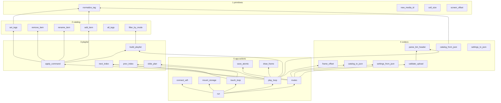
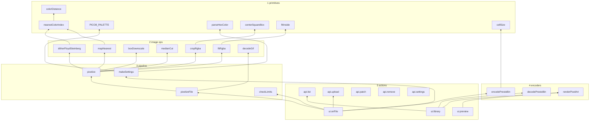

# Implementation Plan: Presto Wi-Fi Gallery

**Branch**: `002-presto-wifi-gallery` | **Date**: 2026-11-06 | **Spec**: [spec.md](spec.md)

## Summary

The Presto becomes a self-contained gallery: a MicroPython **DeviceApp** joins Wi-Fi, serves a
static **WebUi** and a small **HttpApi**, stores `.bin` files + `catalog.json` on microSD (or
flash), and plays a **Playlist** chosen by **ShowMode**/Tags. All image/GIF conversion happens
in the browser with a JS port of the 001 pipeline. To make browser and desktop results
identical, the quantization step (palette, mapping, dithering) is re-specified as our own
documented algorithm and implemented the same way in Python and JS, checked by golden vectors.

## Technical Context

**Language/Version**: MicroPython (Pimoroni Presto firmware) · ES2020 modules in the browser · Python ≥3.10 desktop
**Primary Dependencies**: vendored `microdot` (MIT, single-file async HTTP server) on the device; nothing else
**Storage**: `/sd/gallery/` (microSD) or `/gallery/` (flash): `media/<id>.bin`, `catalog.json`, `settings.json`
**Testing**: pytest (desktop + device pure layers under CPython) · `node --test` (web pure layers; Node 19 present) · manual device smoke test
**Target Platform**: Presto (RP2350, PSRAM, Wi-Fi) · Safari iOS / Chrome
**Performance Goals**: upload→shown < 15 s; playback keeps frame timing ±20 ms while idle
**Constraints**: no build step, no CDN, offline LAN; device RAM — stream .bin files, never load the whole catalog of files
**Scale/Scope**: device ~8 modules, web ~7 modules, ~1500 LOC + tests

## Constitution Check (v1.1.0)

| Principle | How | Status |
|---|---|---|
| I Stratified Design | three runtimes, each with its own 5 layers (below); actions only in top layer; import-guard tests for device (pytest/ast) and web (node test scanning `import` lines) | ✅ |
| II OKF | 11 new entities added and validated; JS/Python names match (`MediaItem`, `ShowMode`, `Playlist`…) | ✅ |
| III Tests | device layers 1–4 run under CPython in pytest; web layers 1–4 under `node --test` | ✅ |
| IV Format | `.bin` v1 unchanged; GIFs use existing frames + `durationMs`; `flags` bit0 = loop set for animations | ✅ |
| V Simplicity | one vendored lib (microdot) with license; plain JS modules; no npm deps | ✅ |
| VI Shared contract | `tests/golden/*.json` generated by Python; JS must match byte-exact | ✅ |

## Key decision: shared quantization algorithm (changes 001)

Pillow's median cut and dithering cannot be reproduced exactly in JS. So the pipeline is split:

1. **prepare** (platform-dependent, tolerance allowed): decode → RGB, crop/fit, area-average down
   to gridSize×gridSize. Desktop: Pillow; browser: Canvas/own GIF decoder + own box filter.
2. **quantize** (exact, shared): our own median cut (deterministic tie rules), nearest-color
   mapping, own Floyd–Steinberg (integer arithmetic, serpentine off). Specified in
   `docs/pixelize-algorithm.md`; implemented in `l2_image_ops.py` (Python) and `web/js/l2-image-ops.js`.
   Works on ≤ 64×64 px so pure Python is fast enough.
3. Animations: one Palette for all frames = median cut over pixels of all frames together.

Golden vectors (`tests/golden/*.json`): grid-sized RGB pixels + PixelizeSettings → expected `.bin` hex.
Generated by `python -m presto_pic_loader.golden` (desktop L5 action), consumed by pytest and node.

## Project Structure

```text
docs/bin-format.md (flags bit0 = loop documented)   docs/pixelize-algorithm.md   docs/device-setup.md
src/presto_pic_loader/            # 001, l2 quantize rewritten to shared algorithm; + golden.py (L5)
device/                           # copied to the Presto root
├── main.py                       # entry: from gallery.l5_app import run; run()
├── secrets.example.py            # WIFI_SSID / WIFI_PASSWORD
├── lib/microdot.py + LICENSE     # vendored
└── gallery/
    ├── model.py                  # DATA: MediaItem, DeviceSettings, ShowMode, BinHeader
    ├── l1_primitives.py          # normalize_tag, new_media_id, cell geometry, clamp
    ├── l2_catalog.py             # pure Catalog ops: add, remove, rename, set_tags, all_tags, filter_by_mode
    ├── l3_playlist.py            # build_playlist, next_index/prev_index, slide_plan(item, slideSeconds)
    ├── l4_codecs.py              # parse_bin_header, frame_offset, catalog/settings JSON (de)serialize, validate_upload
    └── l5_app.py                 # ACTIONS: wifi, storage mount, file I/O, microdot routes, display, touch, asyncio loops
web/                              # served by the device from /web
├── index.html  style.css
└── js/
    ├── l1-primitives.js          # color math, PICO8_PALETTE, sizes (port of l1)
    ├── l2-image-ops.js           # cropBox, fitBox, boxDownscale, medianCut, mapNearest, ditherFS, decodeGif (bytes→RGBA frames)
    ├── l3-pipeline.js            # makeSettings, pixelize(frames, settings) -> PixelArt
    ├── l4-encoders.js            # encodePrestoBin, decodePrestoBin, renderPixelArt (→ ImageData-like RGBA)
    ├── l5-api.js                 # ACTIONS: fetch HttpApi
    └── l5-ui.js                  # ACTIONS: DOM, file input, canvas decode, preview, library, settings
tests/  (desktop + device pytest)   tests/golden/   web/test/*.test.mjs (node --test)
```

## Layers and call graphs

### DeviceApp (MicroPython)



`routes` changes the Catalog only through D3: `apply_command` (catalog, settings, command) -> (catalog, settings, playlist) is a single pure entry for every mutation (upload, rename, retag, delete, settings), which calls
D2 and `build_playlist`. D5 then calls only D3/D4. `draw_frame` gets header data from `play_loop`. Media ids and tag counts also go through D3
(`allocate_media_id`, `tag_counts`). With that, D5 → {D3, D4}, D4 → {D1}, D3 → {D2, D1 (via data)},
D2 → D1. **No upward arrows.** Exception kept as in 001: D4 → D1 constants.

### WebUi (browser)



GIF decoding goes through W3 `pixelizeFile(kind, bytesOrRgba, settings)`, which calls `decodeGif`
(W2) for GIFs, so W5 calls only W3/W4 (and other W5 actions).
Same documented exception as 001: W3/W4 → W1 constants (`PICO8_PALETTE`, `cellSize`).
**No upward arrows.** Guard test parses `import` lines of every `web/js/*.js`.

### Desktop (001) changes

`l2_image_ops`: `adaptive_palette`/`quantize_*` replaced by shared `median_cut`, `map_nearest`,
`dither_floyd_steinberg` (pure Python, integer math). New `golden.py` (L5) writes `tests/golden/`.
Existing outputs change slightly (new palette algorithm) — acceptable, format unchanged.

## HttpApi (contracts/http-api.md)

| Method | Path | Body → Response |
|---|---|---|
| GET | `/` , `/web/*` | static WebUi |
| GET | `/api/status` | `{ip, storage:{kind,free,total}, current:{mediaId,index}, version}` |
| GET | `/api/media` | `[MediaItem…]` |
| POST | `/api/media?name=…&tags=a,b` | raw `.bin` (≤1 MB) → `201 MediaItem` · `400` invalid · `507` no space |
| GET | `/api/media/{id}/file` | raw `.bin` |
| POST | `/api/next`, `/api/prev` | `204`, step the Playlist (remote buttons) |
| PATCH | `/api/media/{id}` | `{name?, tags?}` → MediaItem |
| DELETE | `/api/media/{id}` | `204` |
| POST | `/api/media/{id}/show` | `204`, jumps the Playlist to it |
| GET/PUT | `/api/settings` | DeviceSettings JSON |
| GET | `/api/tags` | `[{label, count}]` |

Upload is streamed to `media/<id>.tmp`, validated (header + exact length), then renamed;
`catalog.json` written to `.tmp` and renamed (atomic on FAT/littlefs).

## Playback (device)

- One asyncio loop for microdot, one for playback, one for touch (poll 50 ms).
- Playback reads the header + palette once per item, creates pens, then reads each frame
  (≤ 4096 bytes) from the file and draws it; next frame waits `durationMs` with `asyncio.sleep_ms`.
- Draw fast path: one `rectangle` per run of equal indices in a row (fewer calls than per-cell).
- Catalog/settings change → new Playlist, current item kept if still present.

## Risks / research (research.md)

- **microSD on Presto**: slot exists; mounting via `machine.SPI` + `sdcard` driver — exact pins and
  whether the firmware bundles `sdcard` must be verified on the device. Fallback: flash.
- **Wi-Fi + mDNS**: `presto.connect()` reads `secrets.py`; mDNS hostname via `network.hostname("presto")`
  — verify; fallback is the IP shown on screen (reserve it in the router).
- **GIF**: own decoder (LZW, disposal methods 0–2, transparency → background) — ~200 lines, testable in node.
- **iOS Safari**: no WebCodecs dependency; Canvas `drawImage` for PNG/JPEG/WebP; HEIC from iPhone photo
  picker is auto-converted to JPEG by Safari.
- **Performance**: HTTP upload while animating — acceptable stutter (spec edge case).

## Complexity Tracking

| Violation | Why Needed | Simpler Alternative Rejected Because |
|---|---|---|
| Two implementations of pixelize (Py + JS) | device can't run Pillow; browser does conversion | server on router/PC rejected by user (needs extra infra) |
| Re-implementing quantization (drop Pillow quantize) | byte-identical results across runtimes | tolerance-only comparison would hide real divergence |
| L3/L4 → L1 constants (all runtimes) | avoid pass-through wrappers | same as 001, approved |
