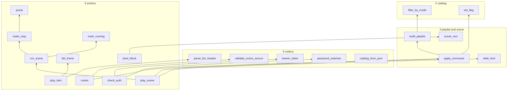
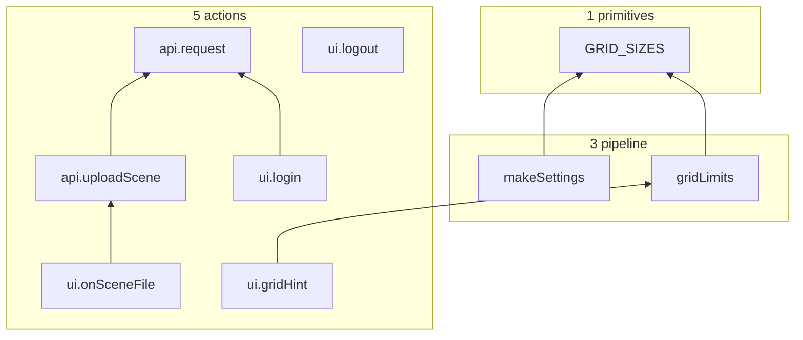
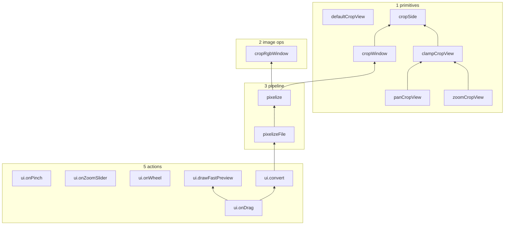

# Implementation Plan: Full-Screen Pictures and Scenes

**Branch**: `003-fullscreen-scenes` | **Date**: 2026-11-08 | **Spec**: [spec.md](spec.md)

## Summary

Add Grids that divide the 240 px screen evenly, draw frames by writing straight into the display
buffer (fast enough for full-screen GIFs), add **Scene** as a second MediaItem kind that runs
unmodified `run(stop)` scripts as slides, and protect the HttpApi with an **AccessPassword**.
Scenes run inside the playback task; their `stop` callback hands control back to the asyncio loop
so the server, touch and Wi-Fi keep working.

## Technical Context

**Language/Version**: MicroPython 1.26 (Presto build, verified on the board) · ES2020 modules · Python ≥3.10
**Primary Dependencies**: vendored `microdot`; nothing new
**Storage**: as 002, plus `<base>/scenes/<id>.py` and `<base>/scene.running`
**Testing**: pytest (desktop + device pure layers) · `node --test` · smoke test on the real Presto
**Target Platform**: Presto (RP2350, 8 MB free RAM, 14 MB flash) · Safari iOS / Chrome
**Performance Goals**: frame drawn in ≤ 40 ms at any Grid; 100 ms GIF frames ±20 ms; status answers ≤ 3 s during a Scene
**Constraints**: no build step, no CDN; stream files; a Scene is trusted code with no sandbox
**Scale/Scope**: about 3 new device modules, 8 changed files across runtimes, ~500 LOC + tests

## Constitution Check (v1.1.0 → v1.2.0 required)

| Principle | How | Status |
|---|---|---|
| I Stratified Design | new code placed per layer below; viper blit, Scene runner and `pixel.py` are layer 5; guard tests extended | ✅ |
| II OKF | add `scene`, `access-password`; update `grid`, `media-item`, `show-mode` before the code | ✅ on approval |
| III Tests | new pure functions tested in pytest/node; blit, pump and Scene run covered by the device smoke test | ✅ |
| IV Format | `.bin` v1 unchanged: width/height are u16; Scenes are not `.bin` files | ✅ |
| V Simplicity | no new dependency | ✅ |
| VI Shared contract | golden vectors extended with Grids 40 and 80 | ✅ |
| Architecture Constraints | "grid sizes 16/32/64" **conflicts** with FR-001 | ⚠ amend to the 8 sizes (MINOR bump, v1.2.0) on approval |

## Key decisions

Measurements on the user's board are in [research.md](research.md).

1. **Direct framebuffer blit.** `memoryview(display)` is the 115 200-byte RGB565 buffer, and pens
   match its byte layout. A viper function copies palette-mapped indices into it: 33 ms for a full
   240×240 frame, versus 655–1091 ms for rectangles. Rectangles stay as the fallback when the
   buffer is unavailable (simulator).
2. **Cooperative Scene execution with a nested asyncio pump.** A Scene is synchronous and called
   from the playback task. Its `stop()` runs one pass of the asyncio loop (`pump`), then returns
   whether the slide is over. Tested on the board: a blocking loop with 97 pumps let another task
   run 97 times. It uses `asyncio.core` internals, so it is isolated in one function.
3. **Real `/pixel.py` file**, replacing the old one on the board. Scenes keep `from pixel import …`.
   It does not create a `Presto`; the app binds the shared instance first. `GRID` stays 32.
   `block` maps cells to `x*240//GRID` … `(x+w)*240//GRID`, giving 7 or 8 px cells with no frame.
4. **Hang recovery by a marker file.** `scene.running` is written with the item id before a Scene
   starts and removed at its first `stop()` call, so unplugging during a normal Scene flags
   nothing. At boot, a leftover marker flags that Scene and it is skipped. Worst case (3 s slides,
   Scenes only) is about 60 000 small writes a day, which flash wear levelling on 14 MB tolerates
   for years.
5. **AccessPassword.** `WEB_PASSWORD` in `secrets.py`. Microdot `before_request` checks
   `Authorization: Bearer …` on `/api/*`; static files stay public as they hold no user data.
   Failures wait so that at most one attempt per second is processed. Scene upload needs it set.
6. **Scene loading without importing.** Source is read, compiled and `exec`-ed in a fresh namespace
   with `__name__ = "scene"`, so an `if __name__ == "__main__"` block does not run.

## Project Structure

```text
device/
├── pixel.py                 # NEW L5: Scene drawing helpers bound to the shared Presto
├── secrets.example.py       # + WEB_PASSWORD
└── gallery/
    ├── model.py             # media_item gains kind, flagged, error; SHOW_MODES + "scenes"
    ├── l2_catalog.py        # filter_by_mode handles kinds; set_flag
    ├── l3_playlist.py       # build_playlist skips flagged; new ops; slide limit for a lone item
    ├── l3_scene.py          # NEW: scene_rect (cell → screen pixels)
    ├── l4_codecs.py         # GRID_SIZES; validate_scene_source; bearer_token; password_matches; catalog fields
    ├── l5_app.py            # auth, scene routes, boot marker check, play dispatch, blit use
    ├── l5_blit.py           # NEW: viper blit_frame; absent under CPython
    ├── l5_clock.py          # NEW: ticks shared by the layer-5 modules
    └── l5_scene.py          # NEW: pump, make_stop, mark_running, run_scene
web/js/
├── l1-primitives.js         # GRID_SIZES
├── l3-pipeline.js           # gridLimits (bytes per frame, max frames, recognizable)
├── l4-encoders.js           # unchanged
├── l5-api.js                # bearer header, 401 handling, uploadScene
└── l5-ui.js                 # password form, log out, scene upload, flags, grid hint
web/index.html, style.css    # password form, scene section, new grid options, default 60
src/presto_pic_loader/       # l1 GRID_SIZES; golden CASES + 40, 80
docs/                        # device-setup, new scene-format.md
knowledge/domain.okf.json    # new and updated entities
.specify/memory/constitution.md  # v1.2.0
```

## Layers and call graph

### DeviceApp additions



D5 → {D3, D4}, D3 → D2, D4 → D1 constants (existing exception). **No upward arrows.**
`pixel.py`, `l5_blit.py` and `l5_scene.py` count as layer 5 in the guard test.

### WebUi additions



W5 → W3/W4 only; W3 → W1 is the existing constants exception. **No upward arrows.**

### CropView (User Story 5, WebUi only)

`CropView = {centerX, centerY, zoom}` in source pixels. The view is data; every gesture is a pure
function from one view to the next. Nothing changes on the device or in the `.bin` format. In crop
mode the window's side is `min(width, height) / zoom`; in fit mode it is `max(width, height) / zoom`,
the window may extend past the picture, and `fitRgbWindow` fills the rest with the background.



`cropRgbWindow` takes a plain `{x, y, side}` rectangle, and `cropRgb` becomes the default rectangle
through it, so results at the default view stay the same. W3 → W1 is the existing exception. UI
gestures need view maths from W1, so `l3-pipeline.js` re-exports `defaultCropView`, `panCropView`,
`zoomCropView`; W5 calls only W3/W4. **No upward arrows.**

Quantizing on every pointer move would be too slow at Grid 240. During a gesture the preview draws
the source through a plain canvas `drawImage`; the exact result is computed when the gesture ends.
The decoded source limit rises from 1024 to 2048 px on the long side so that zoom keeps its detail.

## HttpApi changes ([contracts/http-api.md](contracts/http-api.md))

Every `/api/*` needs `Authorization: Bearer <password>` when a password is set; otherwise `401`.
New: `POST /api/scenes?name=&tags=`. `PATCH /api/media/{id}` accepts `flagged: false`.
`GET /api/status` gains `passwordSet`. Encoded `..` returns `404`.

## Playback

- `play_loop` dispatches on `kind`. Pictures: header, palette to `array("H")`, one reusable
  `bytearray`, `readinto`, `blit_frame`, `presto.update()`.
- Scene: bind `pixel`, write marker, `exec`, `run(stop)`, catch `Exception`/`SystemExit`, flag on
  error, remove marker, clear the screen, `gc.collect()`.
- `stop()`: pump, then `True` if `wake` is set or the slide limit passed.

## Risks

- **`asyncio.core` internals** can change with firmware. Isolated in `pump`; the app pins nothing,
  so the smoke test must be repeated after a firmware update.
- **`compile`** is available on this firmware (checked on the board); syntax is verified at upload.
- **Frame read time** at Grid 240 (57.6 KB from flash) is not measured yet; it decides SC-002.
- **Browser preview at Grid 240** may be slow on phones; preview is debounced.
- **Desktop quantization** is pure Python and may take seconds at Grid 240. Accepted.
- **Scenes in the simulator**: CPython has no pump, so the simulated server pauses during a Scene.
  FR-014 is verified on the real device only.
- **A Scene that never calls `stop`** blocks the server until power-cycled, as the spec allows.

## Complexity Tracking

| Violation | Why Needed | Simpler Alternative Rejected Because |
|---|---|---|
| `pump` uses `asyncio.core` internals | FR-014 needs the server alive during blocking Scenes | core 1 thread: Presto firmware drives the display; pausing the server breaks FR-014 |
| `/pixel.py` outside `gallery/` | existing Scenes import `pixel` at top level; SC-004 needs them unmodified | rewriting Scenes contradicts the request |
| L3/L4 → L1 constants | as 001, 002 | approved earlier |
