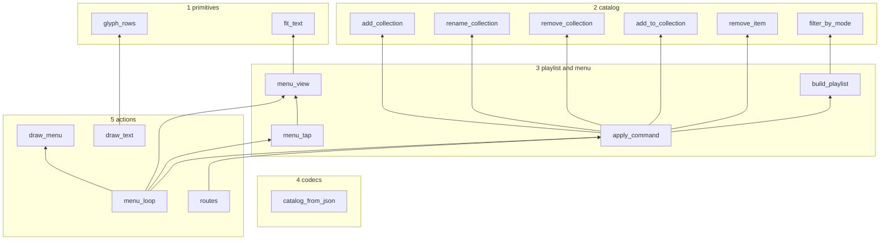

# Implementation Plan: Batch Upload, Collections and the Device Menu

**Branch**: `004-collections-menu` | **Date**: 2026-11-09 | **Spec**: [spec.md](spec.md)

## Summary

Add an **UploadQueue** in the browser, **Collection** as a new part of the Catalog with a new
ShowMode, and a touch **DeviceMenu** on the Presto. The menu is a pure state machine in the lower
layers, so it is tested without hardware; layer 5 only draws its rows and forwards taps.

## Technical Context

**Language/Version**: MicroPython 1.26 Presto build · ES2020 modules
**Primary Dependencies**: nothing new
**Storage**: `collections` list inside `catalog.json`
**Testing**: pytest (device pure layers) · `node --test` · simulator · smoke test on the real Presto
**Performance Goals**: menu reacts to a tap in ≤ 300 ms; saving 200-item Collections unnoticeable
**Constraints**: no build step; the browser decodes one picture at a time; layer rules per runtime
**Scale/Scope**: ~700 LOC + tests

## Constitution Check (v1.2.0)

| Principle | How | Status |
|---|---|---|
| I Stratified Design | Collection ops in D2/D3, menu in D3, font data in D1, drawing and touch in D5; queue state transitions in W3, DOM in W5 | ✅ |
| II OKF | add `collection`, `upload-queue`, `device-menu`; update `show-mode`, `device-settings` before the code | ✅ on approval |
| III Tests | all pure additions tested; menu navigation tested without hardware | ✅ |
| IV Format | `.bin` unchanged; `catalog.json` gets one optional key, old files load | ✅ |
| V Simplicity | no new dependency; own small font table | ✅ |
| VI Shared contract | conversion unchanged, golden vectors unaffected | ✅ |

## Key decisions

1. **Explicit membership.** A Collection stores media ids. "Add all with a Tag" copies the ids once.
2. **One change path.** New `apply_command` ops: `createCollection`, `renameCollection`,
   `deleteCollection`, `addToCollection`, `removeFromCollection`. The menu emits the existing
   `setSettings` command, so WebUi and menu cannot diverge.
3. **Silent uploads.** `POST /api/media` and `/api/scenes` accept `show=0` and `collection=<id>`.
   `apply_command`'s `upload` takes `show: false`, adding the item without moving the Playlist.
4. **Menu as data.** `menu_view(menu, catalog, settings)` returns a title and rows;
   `menu_tap(menu, x, y, catalog, settings)` returns the next menu and an optional command. Pages,
   Back, tag toggling and empty rows all live there.
5. **Cyrillic on the screen.** Checked on the board: the firmware's `bitmap8` font draws wrong
   letters for Cyrillic (Ж as O, К as U, я as I), and its vector `sans` font hung the board on
   Cyrillic text, so it is never used. The menu draws from our own 5×7 table for Latin and Cyrillic
   in `l1_font.py`, as filled cells at scale 2–3. No third-party font data, so no license question.
6. **Menu while a Scene runs.** The long press is seen through `pump`; the Scene is stopped through
   `wake`, then the playback task opens the menu.
7. **Queue keeps only `File` objects** and CropViews; each file is decoded when it is opened or
   uploaded, and released afterwards.

8. **Queue setup is layered, value by value.** A queue-level `shared` setup holds what the reference
   file sets: `conversion`, `view`, `tags`, `collection`. An entry stores only its own differences in
   `own`. The value used is `{...shared, ...entry.own}`. Editing the reference writes to `shared`;
   editing another file writes to its `own`. New files added later follow `shared`. If the reference
   is removed, `shared` stays and the next picture becomes the reference. All of this is pure, in W3.
9. **CropView is shared in relative form.** `shared.view` is `{x, y, zoom}` with the center as a
   fraction of the picture. Each file turns it into its own CropView when opened or uploaded, through
   `clampCropView`. Changing fit resets the CropView of the files following that fit, as it does now.
10. **The tag field is the source of truth.** Labels are drawn from the text of the field, a click
    rewrites the field through `toggleTag(text, label)`. One component serves both forms.
11. **Edit is one command.** New op `editItem(mediaId, name?, tags?, collectionIds?)` validates first,
    then changes everything and saves once, so the flash is written once and a bad id changes nothing.
    `PATCH /api/media/{id}` uses it; `flagged` stays separate. The two `prompt()` calls become a
    `<dialog>` form.

## Project Structure

```text
device/gallery/
├── model.py          # collection(); catalog "collections"; SHOW_MODES + "collection"; selectedCollection
├── l1_font.py        # NEW: 5×7 glyph table, text layout (cut with ellipsis)
├── l2_catalog.py     # Collection ops; set_item_collections; remove_item also cleans Collections
├── l3_playlist.py    # new ops incl. editItem; upload with show=false; settings validation
├── l3_menu.py        # NEW: menu_open, menu_view, menu_tap, menu_timeout
├── l4_codecs.py      # catalog load defaults
├── l5_app.py         # routes, show/collection args, playback pause for the menu
└── l5_menu.py        # NEW: draw rows, poll taps, run the menu loop
web/js/
├── l1-primitives.js  # relative CropView: toRelativeView, fromRelativeView
├── l3-pipeline.js    # queue transitions; referenceEntry, entrySetup, setSetupValue, resetEntry; toggleTag
├── l5-api.js         # collection endpoints, upload options
└── l5-ui.js          # queue list, batch upload, collections panel, multi-select in the library
```

## Layers and call graph



D5 → D1 for `glyph_rows` would skip layers, so `l3_menu` re-exports the font lookup and `draw_text`
goes through it. D5 → {D3, D4}, D3 → {D2, D1}. **No upward arrows.**

## HttpApi additions

| Method | Path | Body → Response |
|---|---|---|
| GET | `/api/collections` | `[Collection]` |
| POST | `/api/collections` | `{name}` → `201 Collection` · `400` duplicate |
| PATCH | `/api/collections/{id}` | `{name}` → Collection |
| DELETE | `/api/collections/{id}` | `204`, items stay |
| POST | `/api/collections/{id}/items` | `{mediaIds: [...]}` → Collection |
| PATCH | `/api/media/{id}` | adds `collections: [id]`; name, tags, collections apply as one change · `404` unknown Collection |
| POST | `/api/media/bulk` | `{action: "delete" \| "addTag" \| "addToCollection", mediaIds, tag?, collectionId?}` → `{count}` |
| DELETE | `/api/collections/{id}/items/{mediaId}` | `204` |
| POST | `/api/media`, `/api/scenes` | adds `show=0`, `collection=<id>` |
| GET/PUT | `/api/settings` | adds `selectedCollection`; `showMode` accepts `collection` |

## Risks

- **Touch accuracy** of small rows on the real screen; rows are 40 px, checked on the device.
- **Tap passing through**: the tap that opens or changes a menu screen must be released before the
  next one counts; `menu_loop` waits for release.
- **Phone memory** with 2048 px decoding in a batch; pictures are released after each upload.
