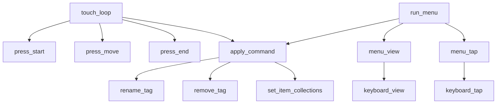

# Implementation Plan: Device gestures and library management on the Presto

**Branch**: `005-device-gestures-library` | **Date**: 2026-11-09 | **Spec**: [spec.md](spec.md)

## Summary

Replace the tap-or-hold touch logic with a pure **Gesture** classifier, add **Pause** and persistent
**Brightness**, and extend the **DeviceMenu** with screens for the current item, Collections and Tags,
including an **OnScreenKeyboard**. All decisions stay in pure layers and are tested without hardware.
Layer 5 only samples the touch screen, draws and applies commands.

## Technical Context

**Language/Version**: MicroPython 1.26 Presto build
**Primary Dependencies**: nothing new
**Storage**: one optional key `brightness` in `settings.json`; `catalog.json` unchanged
**Testing**: pytest (device pure layers) · simulator · smoke test on the real Presto
**Performance Goals**: gesture response ≤ 300 ms on pictures; menu row or key ≤ 500 ms with 200 items
**Constraints**: touch is sampled about every 50 ms, and only at `stop` calls during a Scene; 240×240 screen
**Scale/Scope**: ~600 LOC + tests; the WebUi is not changed

## Constitution Check (v1.2.0)

| Principle | How | Status |
|---|---|---|
| I Stratified Design | Tag ops in D2, `apply_command` ops, Gesture, keyboard and menu in D3, sampling and drawing in D5 | ✅ |
| II OKF | add `gesture`, `brightness`, `pause`, `on-screen-keyboard`; update `device-menu`, `device-settings` before the code | ✅ |
| III Tests | classifier, keyboard, menu navigation, new ops and settings compatibility are tested | ✅ |
| IV Format | `.bin` unchanged; old `settings.json` loads with default brightness | ✅ |
| V Simplicity | no dependency; reuses the 5×7 font, the menu cells and existing commands | ✅ |
| VI Shared contract | conversion unchanged, golden vectors unaffected | ✅ |

## Key decisions

1. **Gesture is a small pure state machine.** `press_start(x, y, ms)`, `press_move(press, x, y, ms)`,
   `press_end(press)` return data. Once the finger has moved over 20 px from its start, the press
   can no longer be a tap or a long press. On release, a total move of at least 40 px is a swipe along
   its longer axis, under 20 px is a tap, and anything between is ignored. Long press: 1000 ms with
   no such movement.
2. **Brightness does not rebuild the Playlist.** New op `setBrightness(level)` returns early like
   `next` and `prev`. A normal `setSettings` would reshuffle the slide order, so it is not used.
   `change` does not wake the player for this op, and the player moves on from the newest state,
   so brightness neither restarts an item nor stops the slideshow.
3. **Settings from the browser cannot reset brightness.** `validate_settings` accepts the key, snaps it
   to a known level, and `setSettings` keeps the current level when the key is absent. The WebUi sends
   only the fields it knows.
4. **Pause lives in layer 5**, as a flag on the app, never stored. When paused, `play_loop` does not
   send `next`: it replays the item. A Scene's time limit is checked against the flag, so a running
   Scene is not restarted. Toggling pause does not set `wake`, so nothing restarts.
5. **Pause mark.** It is a small mark drawn after each frame while paused. On resume, a still picture
   is redrawn from its frame so the mark goes away. A Scene gets no lasting mark, since it draws for itself.
6. **The menu emits commands.** `menu_tap` now returns `(menu, command or None)` instead of new
   settings, so every device change goes through `apply_command`, like the HttpApi. New ids are
   allocated in layer 5, as in the `POST /api/collections` route.
7. **"Эта картинка" holds a media id** taken from the Playlist when the menu opens, so it is unaffected if
   the picture leaves the Playlist after an edit. Each toggle sends one `editItem`, so one touch is one save.
8. **New catalog ops.** `renameTag(old, new)` and `removeTag(tag)` in D2 apply to every item through
   the existing tag normalization, which makes the merge on rename automatic. Selected Tags follow
   the rename or removal in the same command.
8a. **A refused change keeps the screen.** Layer 5 catches a rejected command and asks
   `menu_rejected` for the screen to show, so bad names need no second set of rules in the menu.
9. **Keyboard as data.** `keyboard_open(title, text, action)`, `keyboard_view`, `keyboard_tap`. The
   grid has 6 columns and 4 rows of 40 px keys. Pages: Russian 1 and 2, Latin 1 and 2; digits and punctuation fill the second page of each. The bar
   has page switch, space, backspace and OK. On empty text, backspace is labelled "Отмена" and cancels.
10. **Main screen stays at 8 cells.** "Настройки" becomes "Ещё", so reaching a Collection to show
    still takes at most 3 taps. Management screens use the same `_paged` lists and a 60 s timeout.

## Project Structure

```text
device/gallery/
├── model.py           # default brightness
├── l2_catalog.py      # + rename_tag, remove_tag
├── l3_playlist.py     # + renameTag, removeTag, setBrightness; brightness in settings
├── l3_gesture.py      # NEW: press_start, press_move, press_end
├── l3_keyboard.py     # NEW: keyboard_open, keyboard_view, keyboard_tap
├── l3_menu_cells.py   # NEW: cells, bar, paging shared by the menu screens
├── l3_menu.py         # "Ещё", commands instead of settings
├── l3_menu_library.py # NEW: screens for the current item, Collections, Tags
├── l5_menu.py         # keyboard drawing, longer timeout, applies commands
└── l5_app.py          # touch_loop by gestures, pause, backlight
device/sim/presto.py   # set_backlight stub
tests/device/
├── test_device_gesture.py   # NEW
├── test_device_keyboard.py  # NEW
├── test_device_menu.py      # updated; library screens
├── test_device_pure.py      # tag ops, setBrightness, old settings
└── test_device_layers.py    # new modules
```

## Call graph (new parts)



## HttpApi

No new routes. `GET` and `PUT /api/settings` gain the optional `brightness`.

## Risks

- **Scenes and heavy GIFs**: touch sampling is sparse, so a fast swipe can be lost. Measure on the
  board; long press is unaffected.
- **Backlight call**: `set_backlight` is not used in the project yet. Check it on the board first.
- **Save time** on toggles with 200 items; measure on the microSD and on the flash fallback.
- **Key accuracy**: 40 px keys at the screen edge; check on the device.
- **Muscle memory**: tapping the side no longer changes pictures, as agreed.
