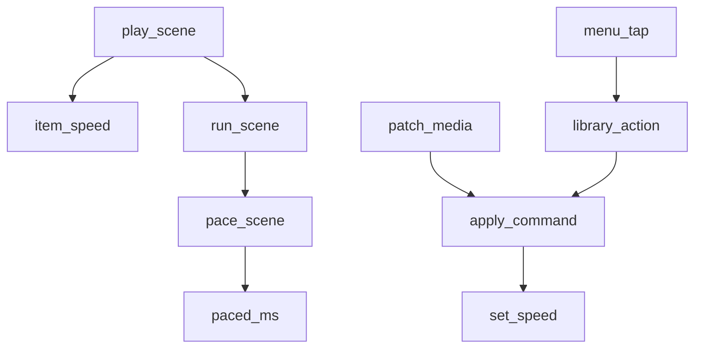

# Implementation Plan: Scene speed

**Branch**: `006-scene-speed` | **Date**: 2026-11-09 | **Spec**: [spec.md](spec.md)

## Summary

Each Scene gets an optional stored **SceneSpeed**. While a Scene runs at a speed other than 1×, the
gallery replaces the Scene's `time` with a copy whose pauses are divided by the speed. The Scene file is
never touched. The speed is edited through the existing `editItem` command, from the browser edit form
and from a new device menu screen.

## Technical Context

**Language/Version**: MicroPython 1.26 Presto build · vanilla JS (WebUi)
**Primary Dependencies**: nothing new
**Storage**: one optional key `speedPercent` per item in `catalog.json`
**Testing**: pytest (device pure layers and the pacing with a fake clock) · simulator · timing on the real Presto
**Performance Goals**: a menu row responds as other rows do (about 0.4 s with 200 items on the microSD)
**Constraints**: a slow speed must not delay touches or the server; 1× must not change anything
**Scale/Scope**: ~120 LOC + tests

## Constitution Check (v1.2.0)

| Principle | How | Status |
|---|---|---|
| I Stratified Design | levels in data, `set_speed` in D2, menu and arithmetic in D3, replacing `time` in D5 | ✅ |
| II OKF | add `scene-speed`; update `scene` before the code | ✅ |
| III Tests | stored value, refused values, old items, menu screen, pacing with a fake clock | ✅ |
| IV Format | `.bin` unchanged; an old `catalog.json` loads, a missing speed means 1× | ✅ |
| V Simplicity | no dependency; reuses `editItem`, the PATCH route, the menu list screens | ✅ |
| VI Shared contract | conversion unchanged, golden vectors unaffected | ✅ |

## Key decisions

1. **Stored as whole percent.** `speedPercent` is one of 25, 50, 100, 200, 400 (`SPEED_PERCENTS` in
   `model.py`). Absent or unknown means 100 (`item_speed`), so no migration is needed and a damaged value
   cannot stop a Scene.
2. **`set_speed` in D2** refuses an unknown value or a non-Scene with `ValueError`, like `set_flag`.
   `editItem` gains an optional `speedPercent`, so one PATCH stays one save and a bad value changes nothing.
3. **Replace `time` after the file loads and before `run`.** `pace_scene(namespace, percent, stop)` looks
   through the Scene's globals and replaces whatever came from `time`: the module under any name
   (`import time`, `import utime as t`) and directly imported `sleep`, `sleep_ms`, `sleep_us`. So a Scene needs
   no particular import style.
4. **The copy is a plain object**, with every attribute of `time` copied by `dir` and `setattr` and the
   sleep functions overridden. `ticks_ms` and the rest keep working and no `__getattr__` support is needed.
5. **At 100 nothing is replaced**, so 1× runs exactly the code path of today (FR-004).
6. **Long pauses are cut into pieces of at most 100 ms**, calling `stop()` between them. `stop()` already
   serves the touch and the server, so 0.25× does not make the device sluggish. If `stop()` says the Scene
   must end, the pause ends early and the Scene's own next `stop()` sees the same answer.
7. **Slide time does not change.** `make_stop` is untouched and measures real time.
8. **A new speed restarts the Scene**, through the usual `wake` of `change`, as any edit does. Reading the
   speed live while running would add state for little gain.
9. **Device menu:** "Эта картинка" gets a "Скорость: 2x" row for Scenes only, opening `itemSpeed`, five
   marked buttons in two columns, so they fit on one screen. A tap sends one `editItem`. Device labels use a
   Latin `x`, which the 5×7 font has.
10. **Browser:** a `<select>` in the edit dialog, hidden for pictures and GIFs, with a short note that the
    speed changes the Scene's pauses. `speedPercent` is sent for Scenes only. The card reads
    `сцена · 2× · 4.1 КБ` when the speed is not 1×.

## Collection speed (User Story 3)

11. **No new stored field.** A Collection's speed writes `speedPercent` on each of its Scenes, so playback,
    `pace_scene` and `catalog.json` do not change, and there is no question of which speed wins while playing.
12. **`set_collection_speed` in D2**, in one pass over the items, so a large Collection costs one list copy and
    one save. It raises `KeyError` for an unknown Collection and `ValueError` for an unknown speed or a Collection
    without Scenes, as `set_speed` does.
13. **`collection_scenes` and `common_speed` in D2** give the Scenes of a Collection and their shared speed, or
    `None` when they differ. A new `setCollectionSpeed(collectionId, speedPercent)` command goes through
    `apply_command`, so the Scene on screen restarts through the usual `wake`.
14. **Device menu:** the Collection card gets "Скорость: 2x" or "Скорость: разная", only with Scenes present,
    between "Картинки" and "Удалить". It opens `collectionSpeed`, the same five buttons as `itemSpeed`, from one
    shared view function.
15. **Browser:** a `<select>` in the Collection row, with a disabled "разная" option when the speeds differ. It
    applies on change and asks first only when the speeds differ. The row must stay usable at phone width.
16. **HTTP:** the existing `PATCH /api/collections/<id>` takes `speedPercent` instead of `name`. A bad value or a
    Collection without Scenes returns 400, an unknown Collection 404.

## Project Structure

```text
device/gallery/
├── model.py            # SPEED_PERCENTS, DEFAULT_SPEED
├── l2_catalog.py       # + item_speed, set_speed, collection_scenes, common_speed, set_collection_speed
├── l3_playlist.py      # editItem takes speedPercent; setCollectionSpeed command
├── l3_scene.py         # + paced_ms, speed_label
├── l3_menu_library.py  # "Скорость" rows, itemSpeed and collectionSpeed screens
├── l5_scene.py         # + pace_scene; run_scene takes the speed
└── l5_app.py           # passes the speed; both PATCH routes accept speedPercent
web/
├── index.html          # speed field in the edit dialog
├── js/l5-api.js        # setCollectionSpeed
└── js/l5-ui.js         # fill, send, show on the card; speed in the Collection row
docs/scene-format.md    # how the speed works, and what it cannot change
knowledge/domain.okf.json  # Collection sets the SceneSpeed of its Scenes
tests/device/
├── test_device_scene_speed.py  # NEW: set_speed, item_speed, paced_ms, pace_scene, Collection speed
├── test_device_menu.py         # itemSpeed and collectionSpeed screens
└── test_device_layers.py       # updated imports
```

## Call graph (new parts)



## HttpApi

No new routes. `PATCH /api/media/<id>` accepts the optional `speedPercent`, and `PATCH /api/collections/<id>`
accepts `speedPercent` in place of `name`. Items in `GET` responses carry it once set; the WebUi treats a
missing value as 100.

## Risks

- **Real gain at 2× and 4×** depends on how long a frame takes to draw. Measured on the board (ms per frame at
  1×, 2×, 4×): `scene_storm` 728, 322, 208; `scene_storm2` 742, 502, 366; `scene_dutch` 806, 539, 422;
  `scene_watch` 898, 619, 504. Three of the four are limited by drawing, 300 to 400 ms per frame.
- **Replacing a name in the Scene's globals** works on the board for `import time`, `import time as t` and
  `from time import sleep, sleep_ms`.
- **`stop()` inside a pause** clears the "Scene is starting" marker a little earlier for a Scene that
  pauses before its first own `stop()`. This only shortens the hang detection for a Scene already past its setup.
- **Depends on 005**, which is not committed yet: this branch holds both sets of changes until 005 is committed.
