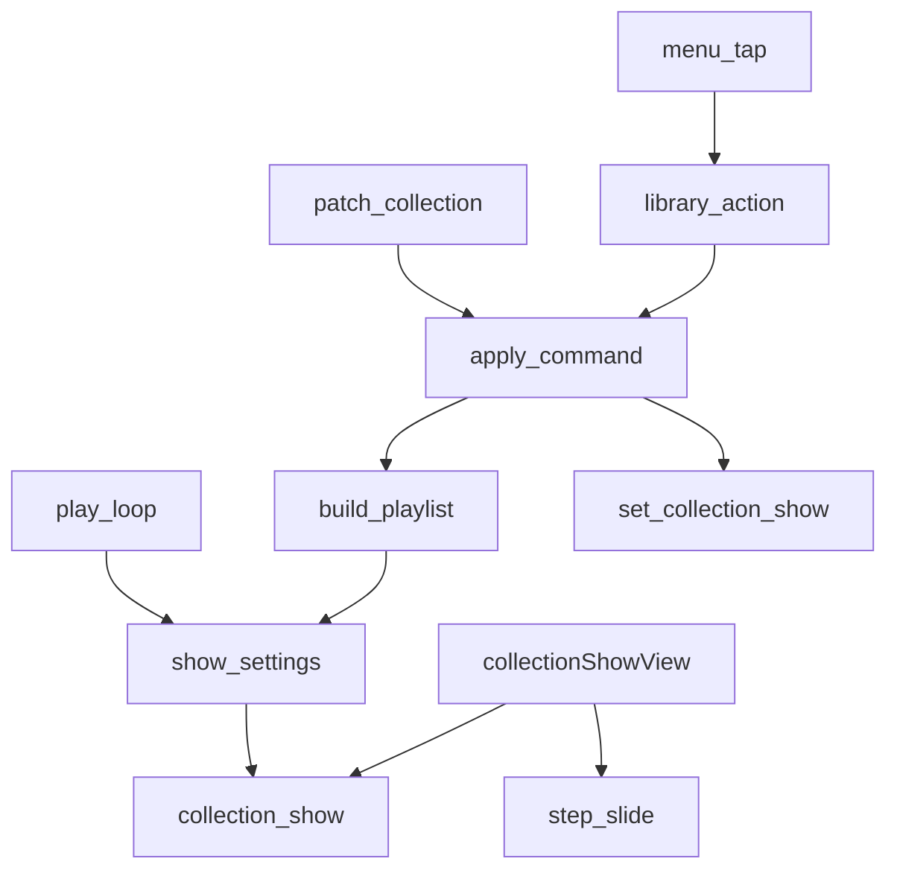

# Implementation Plan: Show settings per Collection

**Branch**: `008-collection-show-settings` | **Date**: 2026-11-12 | **Spec**: [spec.md](spec.md)

## Summary

A Collection gets two optional keys, `slideSeconds` and `shuffle`. One pure function in D3,
`show_settings(catalog, settings)`, returns the DeviceSettings with them applied while that Collection is
the ShowMode; the Playlist and the player read the slide time and order only through it. A new
`setCollectionShow` command changes or clears them, from a new "Показ" screen on the device's Collection card
and from a new "Показ" dialog in the browser. The 006 Collection scene speed moves into both screens unchanged.

## Technical Context

**Language/Version**: MicroPython 1.26 Presto build · vanilla JS (WebUi)
**Primary Dependencies**: nothing new
**Storage**: two optional keys per Collection in `catalog.json`; `formatVersion` stays 1
**Testing**: pytest (`tests/device/`) · `node --test` (`web/test/`) · simulator · one check on the real Presto
**Performance Goals**: a menu tap responds as other rows do (about 0.4 s with 200 items on the microSD)
**Constraints**: no change of behaviour for Collections without own values and for the other ShowModes
**Scale/Scope**: ~200 LOC + tests

## Constitution Check (v1.2.0)

| Principle | How | Status |
|---|---|---|
| I Stratified Design | keys in data, D2 `set_collection_show`, D3 `show_settings` + menu screen, D5 reads through D3 | ✅ |
| II OKF | add `collection-show-settings`; update `collection`, `device-settings`, `device-menu` before the code | ✅ |
| III Tests | stored/cleared/refused values, effective settings per ShowMode, Playlist order, menu screen, web summary | ✅ |
| IV Format | `.bin` unchanged; an old `catalog.json` loads, missing keys mean "как везде" | ✅ |
| V Simplicity | no dependency; reuses the PATCH route, `_fixed_view`, `SLIDE_STEPS`, `validate_settings` limits | ✅ |
| VI Shared contract | conversion unchanged, golden vectors unaffected | ✅ |

## Key decisions

1. **Stored inside the Collection.** `{"collectionId", "name", "mediaIds", "slideSeconds"?, "shuffle"?}`.
   A key that is absent means "как везде"; clearing removes the key, so the file of a Collection without own
   values looks exactly as today. Rename, add/remove items keep the keys (`dict(c, **changes)` already does).
2. **Reading is tolerant, writing is strict.** `collection_show(entry)` in D2 returns
   `{"slideSeconds": int|None, "shuffle": bool|None}` and treats a broken stored value as None (the Collection
   still plays). `set_collection_show(catalog, id, changes)` in D2 raises `KeyError` for an unknown Collection
   and `ValueError` for a non-integer time or a non-bool order; a time is clamped to 3–600, with the limits
   moved from `l3_playlist.py` to `model.py` so D2 can use them. `None` in `changes` clears a key; a key not in
   `changes` stays as it is.
3. **One place decides the effective values.** `show_settings(catalog, settings)` in D3 returns `settings` itself
   when ShowMode is not "collection" or the Collection has no own values, otherwise a copy with them applied.
   `build_playlist` uses it for `shuffle`, `play_loop` in `l5_app.py` uses it for `slideSeconds`. The stored
   DeviceSettings are never changed by it (FR-008), and `GET /api/settings` keeps returning the general ones.
4. **New command** `setCollectionShow(collectionId, slideSeconds?, shuffle?)` through `apply_command`, so the
   Playlist is rebuilt with `reposition` (item on screen stays) and the player wakes, as for `setSettings`.
5. **Device menu.** The Collection card's "Скорость" row is replaced by "Показ" (always present), opening
   `collectionShow`:
   - `Своё время: вкл/выкл` → `("ownSlide", None)`; turning on sends the current general time;
   - `−` / `Слайд N с` / `+` in the layout of the "Настройки" screen; the buttons are inactive when own time
     is off; the step uses the existing `_step_slide`, moved from `l3_menu.py` to `l3_menu_cells.py` so both
     menu modules can use it without importing each other;
   - `Порядок: как везде → по кругу → вперемешку → как везде` → `("ownOrder", None)`;
   - `Скорость сцен: 2x / разная` → opens the existing `collectionSpeed` screen, only with Scenes present;
     `BACK_TO["collectionSpeed"]` becomes `collectionShow`.
   `collectionShow` joins `COLLECTION_SCREENS`, so `library_settled` handles a Collection deleted meanwhile.
   The "Настройки" screen gets an info row "У коллекции свои" when `show_settings` differs from `settings`.
6. **HTTP.** `PATCH /api/collections/<id>` accepts `slideSeconds` and/or `shuffle` (each a value or `null` to
   clear) → `setCollectionShow`; `name` and `speedPercent` keep working. Bad values → 400, unknown → 404.
   `GET /api/collections` already returns the whole Collection, so the keys appear with no route change.
7. **Browser.** A new pure module `web/js/l3-show.js`: `collectionShowSummary(collection)` ("60 с · вперемешку"
   or ""), `ownShowNote(collection)`, `showForm(collection)`, `showPatch(formValues)` → the PATCH body with `null` for
   cleared values. `l5-ui.js` adds a "Показ" button and the summary to each Collection row, and a `<dialog>`
   with: a number 3–600 (empty means "как в настройках", so there is no extra checkbox), select "Порядок" (как в настройках / по кругу / вперемешку),
   and the 006 scene speed select moved here from the row (with its "разная" question). The general settings
   form shows a note under the Collection select when that Collection overrides something. The row stays one
   line at phone width because the speed select leaves it.
8. **What is not added**: brightness, fit/frame and a per-Collection scene speed (see spec Assumptions).

## Project Structure

```text
device/gallery/
├── model.py              # SLIDE_MIN_SECONDS, SLIDE_MAX_SECONDS (moved here)
├── l2_catalog.py         # + collection_show, set_collection_show
├── l3_playlist.py        # + show_settings; build_playlist uses it; setCollectionShow command
├── l3_menu_cells.py      # + SLIDE_STEPS, step_slide (moved from l3_menu.py)
├── l3_menu.py            # "У коллекции свои" row in Настройки
├── l3_menu_library.py    # "Показ" row, collectionShow screen, ownSlide / ownOrder actions
└── l5_app.py             # play_loop reads the slide time through show_settings; PATCH takes the keys
web/
├── index.html            # "Показ коллекции" dialog
├── js/l3-show.js         # NEW: summary, effective values, PATCH body (pure)
├── js/l5-api.js          # + setCollectionShow
└── js/l5-ui.js           # row summary + button, dialog, note in the settings form; speed select moves
docs/device-setup.md      # the "Показ" screen
knowledge/domain.okf.json # CollectionShowSettings; Collection, DeviceSettings, DeviceMenu updated
tests/device/
├── test_device_collection_show.py  # NEW: D2 store/clear/refuse/tolerate, show_settings, Playlist, command
├── test_device_menu.py             # collectionShow screen, taps, deleted Collection, Настройки note
└── test_device_layers.py           # updated imports
web/test/
└── show.test.mjs                   # NEW: summary, effective values, PATCH body
```

## Call graph (new parts)



## HttpApi

No new routes. `PATCH /api/collections/<id>` body may now hold `slideSeconds` (integer or `null`) and
`shuffle` (boolean or `null`); the response is the updated Collection, as for `name`.

## Risks

- **Two places for the slide time** can confuse: the general "Настройки" would seem to do nothing while a
  Collection with own time is shown. Mitigated by the "У коллекции свои" row on the device and the note in the
  browser form.
- **Moving the speed select** out of the Collection row changes the 006 browser layout; the behaviour stays.
- **Depends on 005–007**, which are not committed: this branch holds all of them until they are committed.
- **`.specify/feature.json` and `CLAUDE.md`** still point at 007; they are switched to 008 once this plan is approved.
