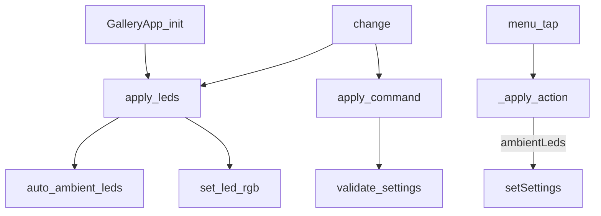

# Implementation Plan: Ambient LEDs follow the screen

**Branch**: `010-presto-ambient-leds` | **Date**: 2026-11-12 | **Spec**: [spec.md](spec.md)

## Summary

One boolean in DeviceSettings, `ambientLeds` (default on). Layer 5 turns the firmware's
`presto.auto_ambient_leds(...)` on or off from it at start and when it changes, and clears the LEDs when
turning off. The colours then follow every `presto.update()` (pictures, GIFs, Scenes, menu) with no Python
work per frame. The value is switched by a "Подсветка" row in the device "Настройки" screen and by a
checkbox in the browser settings form.

## Technical Context

**Language/Version**: MicroPython 1.26 Presto build · vanilla JS (WebUi)
**Primary Dependencies**: Presto firmware `auto_ambient_leds`, `set_led_rgb`, `NUM_LEDS` (in `../PRESTO/presto.pyi`)
**Storage**: one more key in `settings.json`; an old file loads with the default
**Testing**: pytest (`tests/device/`) · `node --test` (`web/test/`) · simulator · a check on the real Presto
**Performance Goals**: no slower frames (SC-002)
**Constraints**: do not touch the 009 lines (`slide_limit_ms`, `play_scene`, the slide row of `_settings_view`)
**Scale/Scope**: ~60 LOC + tests

## Step 0: check the firmware on the board (needs your OK, it stops the gallery for a minute)

Through `mpremote` in a REPL session: `Presto(full_res=True, ambient_light=True)`, fill the left half red and
the right half blue, `update()`. Also a few frames drawn like the gallery does. Look at the LEDs and time
`update()` with and without the LEDs. Then a soft reset brings the gallery back.

- **It works** → the plan below.
- **It does not** (wrong colours at 480, or slower frames) → **fallback**: `auto_ambient_leds(False)`, and
  layer 5 sets the colours itself after `update()`, at most every 200 ms: a pure layer 3 function
  `led_samples(size, count)` gives the edge points for each LED and `led_colors(pixels)` averages them; layer 5
  reads those points from the framebuffer (RGB565) and calls `set_led_rgb`. The setting, menu, browser and
  tests of the pure parts stay the same; I tell you before taking this path, since it costs a few ms of Python.

## Constitution Check (v1.2.0)

| Principle | How | Status |
|---|---|---|
| I Stratified Design | value in DeviceSettings (data); validation, menu row and toggle in D3; Presto calls only in D5 `l5_app.py` | ✅ |
| II OKF | add `ambient-leds`; update `device-settings`, `device-menu` before the code | ✅ |
| III Tests | default, old file, validation, kept when missing, menu row and tap, web form value | ✅ |
| IV Format | `.bin` and `catalog.json` unchanged; `settings.json` gains an optional key | ✅ |
| V Simplicity | the firmware samples the colours; no new module on the device | ✅ |
| VI Shared contract | conversion unchanged, golden vectors unaffected | ✅ |

## Key decisions

1. **Data.** `default_settings()` gets `"ambientLeds": True`. `validate_settings` reads it as a real boolean
   (`ValueError` for anything else, like `slideSeconds`); missing means `True`.
2. **Kept when not sent.** `apply_command` `setSettings` already keeps `brightness` when the WebUi does not send
   it; the same rule takes `ambientLeds` too (a small loop over the two keys, FR-007).
3. **No restart of the item.** `GalleryApp.change` already skips `wake` for `setBrightness`. It also skips it when
   the only difference between old and new settings is `ambientLeds`, and calls `apply_leds()` when that value changed.
4. **Layer 5.** `apply_leds()` next to `apply_brightness()`: on → `auto_ambient_leds(True)`; off →
   `auto_ambient_leds(False)` and `set_led_rgb(i, 0, 0, 0)` for all `NUM_LEDS`, then `presto.update()` is not needed
   (the LED strip is driven on its own). Called once at start after the settings load. The constructor stays
   `ambient_light=False`, so the LEDs are dark until the settings say otherwise. Calls go through `getattr`
   guards, so the simulator without LEDs keeps working; `device/sim/presto.py` also gets no-op methods.
5. **Device menu.** The "Настройки" screen has 4 rows, all used. The two information rows (address, free space)
   become one information row: the address as the label, "свободно N МБ" as its note (the note slot of the
   cells). Row 3 becomes "Подсветка: вкл / выкл" → `("ambientLeds", None)` → `setSettings` with the value flipped.
   The slide row (009) and "Перемешать" stay as they are.
6. **Browser.** `index.html`: a checkbox `ambientLeds` "Подсветка сзади" under "Перемешать".
   `l5-ui.js`: `renderModeForm` sets it, `modeFormValue` sends it. No new module.
7. **What is not added**: LED brightness, per-Collection LEDs, a separate rule for the menu or pause (spec Assumptions).

## Project Structure

```text
device/gallery/
├── model.py              # default_settings: ambientLeds
├── l3_playlist.py        # validate_settings; setSettings keeps ambientLeds when it is not sent
├── l3_menu.py            # "Подсветка" row; address + free space in one info row; ambientLeds action
└── l5_app.py             # apply_leds(); at start; change() calls it, no wake for an LED-only change
device/sim/presto.py      # no-op auto_ambient_leds, set_led_rgb, NUM_LEDS
web/
├── index.html            # checkbox
└── js/l5-ui.js           # form read/write
docs/device-setup.md      # the "Подсветка" row
knowledge/domain.okf.json # AmbientLeds; DeviceSettings, DeviceMenu updated
tests/device/
├── test_device_ambient_leds.py  # NEW: default, old settings.json, validation, kept when missing, menu row/tap,
│                                #      app: apply_leds on start and on change, no restart (fake Presto)
└── test_device_menu.py          # updated for the merged info row
```

## Call graph (new parts)



## HttpApi

No new routes. `GET /api/settings` returns `ambientLeds`; `PUT /api/settings` accepts it (boolean), keeps it
when it is absent, and answers 400 for a non-boolean.

## Check on the Presto (after you agree)

Copy `model.py`, `l3_playlist.py`, `l3_menu.py`, `l5_app.py` and the web files; restart. Check SC-001 with a
two-colour picture, a GIF and a 64x64 Scene; measure SC-002 on the Scene; switch "Подсветка" off and on from
the menu and from the browser, restart (SC-003).

## Risks

- **Firmware behaviour at 480 is unknown** until step 0; the fallback is defined above.
- **The LED order on the board** is unknown; with the firmware mode it does not matter. With the fallback,
  step 0 also finds which LED is where (light them one at a time).
- **Merged info row** makes the free space smaller text; it stays readable as the other notes are.
- **Same lines as 009?** No: 009 changes the slide row's note; this feature adds rows below it.
